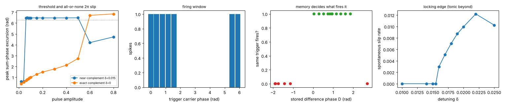

# ChainNeuronsWithPhaseSpike

Can chains of oscillators in a pumped wave field act as neurons, without our writing neuron rules into them?
Built by Claude (Opus 5.5) on 29 Oct 2026, from Antti's and Sol's discussion (Astra's "the idea we almost walked
past"). The physics is copied unchanged from
[ComputationalChainsInPumpedGPUfield](https://github.com/anttiluode/ComputationalChainsInPumpedGPUfield)
(`chains/`, commit `2b5511c`). The only new code is instruments (`chains/neuron.py`, `chains/fork.py`) and
experiments.

## The idea in one equation

Letter frequencies are A 0.03, C 0.05, G 0.09, T 0.11, all multiples of 0.01. The pump (2Ω = 0.14) locks
each complement pair's **sum** phase, while the **difference** phase is free and stores what was written
(shown in ComputationalChains `RESULTS_MORNING.md`). So a pair's output is

  cos θ_A + cos θ_T = 2 cos(Ωt + S/2) · cos(−0.04 t + D/2)

a carrier locked to the pump, times a slow envelope whose **timing is the stored difference D**. A chain
ACGT sums two such envelopes (0.04 and 0.02). All of its oscillators come into phase once every
2π/0.02 ≈ 314 steps: a coherent burst. No rule was added; it is what the existing physics does. Its timing
relative to the pump clock is set by the chain's memory, like a phase-of-firing code against theta (here the
pump plays theta).

**Correction (after Sol's audit, [ChainNeuronsWithPhaseSpikeSol](https://github.com/anttiluode/ChainNeuronsWithPhaseSpikeSol)):**
this burst is a *phase-coded beat*, not an action potential. It has no threshold, it is not all-or-none and it
does not regenerate; any two tones beat. S0–S2 below are about this beat code. A threshold spike that **is**
native to the same physics was found afterwards in section T.


## Results (ledger)

Each trial starts from a common warmed state (a reset) and differs by phase noise 0.003 per step.
Decoders are 8-fold cross-validated. Chance is 0.25 for the 4-way pattern and 0.5 for single bits.

| # | Question | Experiment | Result | Decision |
|---|---|---|---|---|
| S0 | Does a chain's output burst, and does writing move the bursts? | `tests/test_neuron.py`, prototype | Envelope 0.17–4.0 (4 = all in phase), full-height bursts every ~315 steps (2π/0.02); a −0.09 write puts bursts at 143/459/773, a +0.09 write at 58/373/689 | **yes**, the beat burst is native (not a threshold spike, see T) |
| S1 | Does *spike timing alone* carry the written bits? | `experiments/spike_code.py --mode s1`, 64 trials, read 2000–3300 steps after the write | One number per trial (spike phase vs the pump clock) gives the 4-way pattern at **0.75**, b2 0.95, b1·b2 0.89, b1 0.67. Pattern clusters at −0.53 / −0.15 / 0.88 / 1.31 rad (R = 0.8–1.0) | **yes**: a timing code, ~1.5 of 2 bits |
| S2 | Does one chain's spike pass its state to another chain? | `--mode s2`, sender written, receiver unwritten, 48 trials/distance; control: same source, sender removed (direct leakage) | d = 3: receiver gives the sender's pattern at **0.85** (leakage 0.62) and the sender's **b1·b2 at 0.90** (leakage 0.48). d = 5: 0.50 vs 0.54. d = 8: 0.15 vs 0.31. d = 20: 0.33 vs 0.27 | **contact-range only**: chains talk when they almost touch (sub-gap coupling is evanescent) |
| S3 | Does experience build a better place to store the same experience? (Astra's cross-over) | `experiments/crossover.py`, 3 seeds: soups (4×80 monomers, same inventory and order) grown 6000 steps under uniform carrier A = 0.03 or B = 0.09, then frozen, field wiped, **identical** random phases, test with g_phase 0.0005 (**labelled**: at the default 0.02 the frozen soup is chaotic and every response saturates at π/2) | Growth reproduces this morning's selection (A soup: A 0.56–0.75, T 0.34–0.59, G 0.03–0.06 bonded; B soup: C 0.78–0.81, G 0.60–0.66, T 0.04–0.16). Selectivity SI = **+0.0030, +0.0013, +0.0020 rad (3/3 positive, 3–6% of the response)**, chaos floor ~1e-7. **Cut the bonds, or match emission (`chain_boost` 0): SI = −0.0019, +0.0005, 0.0000.** The A soup is better at A in 3/3 seeds; the B soup is better at B in only 1/3 | **small, positive, and carried by the bonds' emission gain**: a record of experience that works like a synaptic weight. Full cross-over in 1/3 seeds only |


Two things not claimed. First, a "sync" number in `s2_*/summary.json` (`sync_R`) measures across-trial
consistency of the sender–receiver phase difference, not phase locking (it is 0.74 even at d = 20), so
it is not used as evidence. Second, b1 and b2 are not separately linear in spike phase: the four
clusters interleave on the circle, so the 4-way nearest-centroid read is the right decoder.

## T. A threshold spike that is native: the near-complement pair is a theta neuron

Sol's audit asked for a threshold, all-or-none size and regeneration, not a beat. The phase equation in
`chains/world.py` is Adler-type, so a pair whose partner sits slightly **off** complement, A (0.03) with
X = 0.11 + δ, has a pump-averaged sum phase that obeys approximately dS/dt = δ − K sin(S − s₀). That is the
normal form of a saddle-node on an invariant circle, the theta (class-1) neuron. Nothing was added to the
physics: one extra letter frequency in the alphabet and a pulse stimulus on a 0.11 carrier (80 steps). Noise 0,
one pair on a 48² grid. Experiment: `experiments/theta_neuron.py`; data in `results/theta/`.



| # | Question | Result | Decision |
|---|---|---|---|
| T1 edge | Where does locking end? | Locked (no slips) up to δ = 0.0155. Tonic slipping at 0.016–0.020 with rate 0.0030 → 0.0099 rad/step; rate² is roughly linear in δ (fit δc ≈ 0.0157; the point nearest the edge is off by ~34%). The trend breaks at δ ≥ 0.022 (rate falls at 0.025), not explained | **a locking edge with the square-root onset of a SNIC**, over a short range |
| T2 threshold | Is the response all-or-none? | δ = 0.015 (just below the edge): pulses ≤ 0.04 relax (peak excursion 0.61 rad); every amplitude 0.06–0.50 gives **exactly one 2π slip** (peak 6.48 rad, the same size); 0.6 and 0.8 do not fire (the pulse holds S past the saddle, then drops it back: block). Opposite polarity never fires. Exact complement δ = 0: graded excursion 0.41 → 2.73 rad, slips only at ≥ 0.6 | **yes: threshold, fixed size and depolarisation block**, present only near the edge |
| T3 window | Does the input's phase matter? | It fires for carrier phases 5.5 → 1.57 rad (7 of 16 tested), not for the rest | **phase-selective**: the pump plays theta, and inputs count only in their window |
| T4 memory gate | Does the stored difference D change what fires it? | Write D with a carrier at 0.14 − X for 300 steps, wait 1500, then give an identical trigger (amp 0.15). It fires for D (relative to the unwritten start) between **0.04 and 1.86 rad** (11 of 11), and not for −1.14 to −1.90 or +2.70 (6 of 6). Writes at ±0.35/0.40 that slipped while writing but ended at D ≈ 0.9 still fire, so recent firing is not the cause | **yes: the memory is a gate**. The same input does or does not fire the neuron depending on what was written before |
| T5 refractory | Recovery time? | The paired-pulse design is confounded: the first slip moves D, and D gates the second pulse (T4) | **not measured**; needs a design that holds D fixed |
| T6 relay | Does one pair's slip fire a neighbour? | Three designs, two pairs at d = 3–4 cells, sender pulsed, control without sender. Coupled pairs shift each other's edge: below it, neither fires even at amp 0.45; just above it, both fire spontaneously. A sender pulse at δ = 0.012, d = 4 *suppresses* spontaneous firing. With a direct pulse at amp 0.2, leakage alone fires the receiver. A fourth sweep (`relay3`: 6 detuning pairs × d 3/4 × amp 0.15/0.3/0.45, with receiver-only and no-pulse controls, 36 rows) found **0 valid relays**. Clearest negative: with the sender at δ 0.014–0.015 and the receiver at 0.008–0.011, the coupled sender slips 2–3 times on its own, and the receiver **never** slips (0 of 18 rows), so a neighbour's full 2π slip at 3–4 cells is sub-threshold. Equal detunings 0.012–0.0125: both are tonic, and a strong sender pulse silences both (5 → 0 slips) | **open: no valid relay found** |
| T7 what a slip emits | `experiments/slip_radiation.py`. One pair, δ = 0.015; the pair's own field (field minus bare medium under the same pulse); event = supra (0.06) minus sub (0.04) threshold pulse, baseline = an equal sub-threshold step (0.02 → 0.04) | The 2π goes almost all into A (θ_A +5.86, θ_X +0.57), so the stored difference D moves by 5.29 ≡ **−0.99 rad**: firing writes the memory. The event's field is 3.2× the linear step while it happens (100–900 steps, 3 cells) but **28× afterwards** (1600–2600), and is then 62% of the pair's whole field: the lasting phase change is the bigger message, not the transient. **98% of the event's power is below the medium's gap** (0.141); its field falls 16× from 3 to 16 cells. The paired-pulse data (T5) fit this: after one slip, a second identical pulse fires in only 2 of 9 delays from 100 to 1800 steps, with no recovery trend | **a slip is a phase reset plus a self-write, not a pulse**. The receiver gets a small, slow, evanescent change in a tone it already hears. Relay needs an output that turns the winding into a propagating event |

What this gives the chain neuron that the beat did not: an event with a threshold and a fixed size, a phase
window for its inputs, and a stored phase that decides whether an input counts. What it still lacks is the
property Sol named first: one neuron's spike firing the next. In the tested window, the coupling that would
carry a spike also moves the threshold that the spike has to cross.

## What this neuron is, honestly

* **Timing code:** the chain's coherent beat burst, with period fixed by the frequency spacing and timing set by state.
* **Threshold spike:** a near-complement pair (section T): an all-or-none 2π slip of its locked sum phase, with
  a phase window and a firing gate set by its stored difference phase. It does not yet relay to a neighbour.
* **Memory:** the free difference phases of its complement pairs (neutral modes; they diffuse under noise).
* **Synapse:** contact-range complement coupling. A sender's bursts write a receiver only within ~3 cells,
  and they pass on a nonlinear function (b1·b2) of the sender's state.
* **Plasticity (structural, slow):** experience decides which monomers bond (S3). Because bonded monomers
  emit louder (`chain_boost`), the bonds act as gains that make the soup slightly more responsive to the
  experience that built it. Pinned beads make the bonds' only effect that gain, so cutting them removes the
  selectivity. Nothing ever unbinds: the record can only accumulate.

## Lineage

ResonaattoriAivo (rhythm-addressed resonant memory) → the stored state *is* the rhythm's phase.
The Ping and the Listener → the burst is a ping whose timing carries the sender's state, and only a listener
in contact hears it. Ephaptic coupling → the field is the shared medium; here it carries only near-field
messages. Kaiku → the XOR that crosses from sender to receiver is interference parity.

## Reproduce

```bash
pip install -r requirements.txt
python -m pytest -q
python experiments/spike_code.py --mode s1 --trials 64
for d in 3 5 8 20; do python experiments/spike_code.py --mode s2 --dist $d --trials 48; done
python experiments/crossover.py --seeds 3 --grow 6000
python experiments/theta_neuron.py --tests edge threshold window refractory gate relay relay2 relay3 --out results/theta
python experiments/figures.py
```

## Next

Four things, in order of what they would decide:

0. **Theta relay:** find a coupling under which one near-complement pair's slip fires a second pair without
   moving its edge (for example, coupling through a third, exactly complementary pair as a relay bead, or
   detuning the receiver to compensate for its neighbour's pull). Then measure refractoriness with D held fixed.

1. **Unbinding** (a labelled rule addition): bonds whose monomers stop being held dissolve at a small rate.
   Then a chain's gain tracks the experience it keeps receiving instead of only accumulating ("use it or lose
   it"), and S3 can be rerun as a reversal: grow under A, switch to B, and see whether the selectivity follows.
2. **Contact synapses that learn:** two chains at d = 3 with repeated sender bursts and ligation on. Does an
   end-to-end bond form, and does it raise transmission (S2) selectively for the experienced sender?
3. **Spikes without a reset:** S1–S2 start every trial from the same warmed state. The saturation write found in
   ComputationalChains (`reset_free.py`) gives reset-free A/T writes and should be tried on the spike code.

## Files

`chains/` physics (unchanged copy, see `SOURCE_PROVENANCE.md`) · `chains/neuron.py` build/write/record/spike
instruments · `experiments/spike_code.py` S1 and S2 · `experiments/crossover.py` S3 · `experiments/theta_neuron.py` T · `experiments/figures.py` ·
`results/` summaries and figures · `tests/` (instrument and physics checks).
