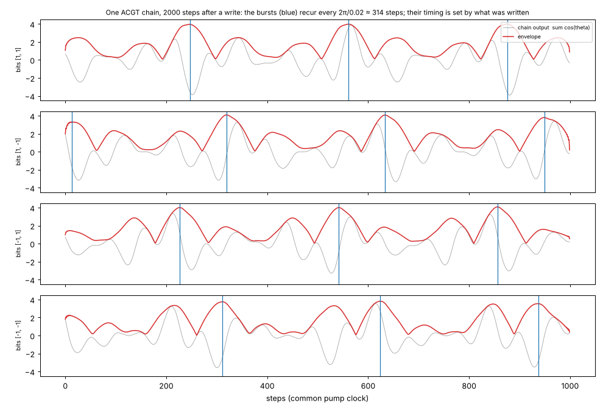
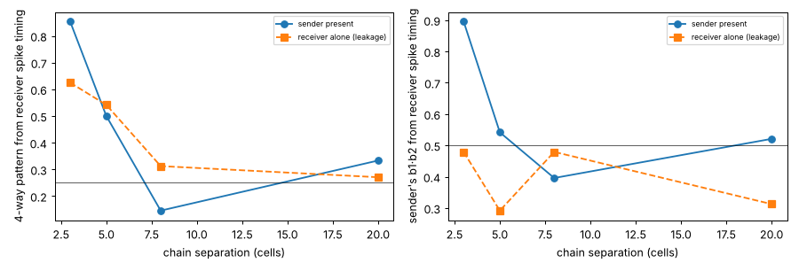

# ChainNeuronsWithPhaseSpike

Can chains of oscillators in a pumped wave field act as neurons, without our writing neuron rules into them?
Built by Claude (Opus 5.5) on 29 Oct 2026, from Antti's and Sol's discussion (Astra's "the idea we almost walked
past"). The physics is copied unchanged from
[ComputationalChainsInPumpedGPUfield](https://github.com/anttiluode/ComputationalChainsInPumpedGPUfield)
(`chains/`, commit `2b5511c`). The only new code is instruments (`chains/neuron.py`, `chains/fork.py`) and
experiments.

## The idea in one equation

Letter frequencies are A 0.03, C 0.05, G 0.09, T 0.11, all multiples of 0.01. The pump (2Ω = 0.14) locks
each complement pair's **sum** phase, while the **difference** phase is free and stores what was written
(shown in ComputationalChains `RESULTS_MORNING.md`). So a pair's output is

  cos θ_A + cos θ_T = 2 cos(Ωt + S/2) · cos(−0.04 t + D/2)

a carrier locked to the pump, times a slow envelope whose **timing is the stored difference D**. A chain
ACGT sums two such envelopes (0.04 and 0.02). All of its oscillators come into phase once every
2π/0.02 ≈ 314 steps: a coherent burst. **That burst is the phase spike.** No spike rule was added; it is
what the existing physics does. Its timing relative to the pump clock is set by the chain's memory, which is
the phase-of-firing code that hippocampal neurons use against the theta rhythm (here the pump plays theta).



## Results (ledger)

Each trial starts from a common warmed state (a reset) and differs by phase noise 0.003 per step.
Decoders are 8-fold cross-validated. Chance is 0.25 for the 4-way pattern and 0.5 for single bits.

| # | Question | Experiment | Result | Decision |
|---|---|---|---|---|
| S0 | Does a chain's output burst, and does writing move the bursts? | `tests/test_neuron.py`, prototype | Envelope 0.17–4.0 (4 = all in phase), full-height bursts every ~315 steps (2π/0.02); a −0.09 write puts bursts at 143/459/773, a +0.09 write at 58/373/689 | **yes**, the spike is native |
| S1 | Does *spike timing alone* carry the written bits? | `experiments/spike_code.py --mode s1`, 64 trials, read 2000–3300 steps after the write | One number per trial (spike phase vs the pump clock) gives the 4-way pattern at **0.75**, b2 0.95, b1·b2 0.89, b1 0.67. Pattern clusters at −0.53 / −0.15 / 0.88 / 1.31 rad (R = 0.8–1.0) | **yes**: a timing code, ~1.5 of 2 bits |
| S2 | Does one chain's spike pass its state to another chain? | `--mode s2`, sender written, receiver unwritten, 48 trials/distance; control: same source, sender removed (direct leakage) | d = 3: receiver gives the sender's pattern at **0.85** (leakage 0.62) and the sender's **b1·b2 at 0.90** (leakage 0.48). d = 5: 0.50 vs 0.54. d = 8: 0.15 vs 0.31. d = 20: 0.33 vs 0.27 | **contact-range only**: chains talk when they almost touch (sub-gap coupling is evanescent) |
| S3 | Does experience build a better place to store the same experience? (Astra's cross-over) | `experiments/crossover.py`, 3 seeds: soups (4×80 monomers, same inventory and order) grown 6000 steps under uniform carrier A = 0.03 or B = 0.09, then frozen, field wiped, **identical** random phases, test with g_phase 0.0005 (**labelled**: at the default 0.02 the frozen soup is chaotic and every response saturates at π/2) | Growth reproduces this morning's selection (A soup: A 0.56–0.75, T 0.34–0.59, G 0.03–0.06 bonded; B soup: C 0.78–0.81, G 0.60–0.66, T 0.04–0.16). Selectivity SI = **+0.0030, +0.0013, +0.0020 rad (3/3 positive, 3–6% of the response)**, chaos floor ~1e-7. **Cut the bonds, or match emission (`chain_boost` 0): SI = −0.0019, +0.0005, 0.0000.** The A soup is better at A in 3/3 seeds; the B soup is better at B in only 1/3 | **small, positive, and carried by the bonds' emission gain**: a record of experience that works like a synaptic weight. Full cross-over in 1/3 seeds only |



Two things not claimed. First, a "sync" number in `s2_*/summary.json` (`sync_R`) measures across-trial
consistency of the sender–receiver phase difference, not phase locking (it is 0.74 even at d = 20), so
it is not used as evidence. Second, b1 and b2 are not separately linear in spike phase: the four
clusters interleave on the circle, so the 4-way nearest-centroid read is the right decoder.

## What this neuron is, honestly

* **Soma and spike:** the chain's coherent burst, with period fixed by the frequency spacing and timing set by state.
* **Memory:** the free difference phases of its complement pairs (neutral modes; they diffuse under noise).
* **Synapse:** contact-range complement coupling. A sender's bursts write a receiver only within ~3 cells,
  and they pass on a nonlinear function (b1·b2) of the sender's state.
* **Plasticity (structural, slow):** experience decides which monomers bond (S3). Because bonded monomers
  emit louder (`chain_boost`), the bonds act as gains that make the soup slightly more responsive to the
  experience that built it. Pinned beads make the bonds' only effect that gain, so cutting them removes the
  selectivity. Nothing ever unbinds: the record can only accumulate.

## Lineage

ResonaattoriAivo (rhythm-addressed resonant memory) → the stored state *is* the rhythm's phase.
The Ping and the Listener → the burst is a ping whose timing carries the sender's state, and only a listener
in contact hears it. Ephaptic coupling → the field is the shared medium; here it carries only near-field
messages. Kaiku → the XOR that crosses from sender to receiver is interference parity.

## Reproduce

```bash
pip install -r requirements.txt
python -m pytest -q
python experiments/spike_code.py --mode s1 --trials 64
for d in 3 5 8 20; do python experiments/spike_code.py --mode s2 --dist $d --trials 48; done
python experiments/crossover.py --seeds 3 --grow 6000
python experiments/figures.py
```

## Next

Three things, in order of what they would decide:

1. **Unbinding** (a labelled rule addition): bonds whose monomers stop being held dissolve at a small rate.
   Then a chain's gain tracks the experience it keeps receiving instead of only accumulating ("use it or lose
   it"), and S3 can be rerun as a reversal: grow under A, switch to B, and see whether the selectivity follows.
2. **Contact synapses that learn:** two chains at d = 3 with repeated sender bursts and ligation on. Does an
   end-to-end bond form, and does it raise transmission (S2) selectively for the experienced sender?
3. **Spikes without a reset:** S1–S2 start every trial from the same warmed state. The saturation write found in
   ComputationalChains (`reset_free.py`) gives reset-free A/T writes and should be tried on the spike code.

## Files

`chains/` physics (unchanged copy, see `SOURCE_PROVENANCE.md`) · `chains/neuron.py` build/write/record/spike
instruments · `experiments/spike_code.py` S1 and S2 · `experiments/crossover.py` S3 · `experiments/figures.py` ·
`results/` summaries and figures · `tests/` (instrument and physics checks).
